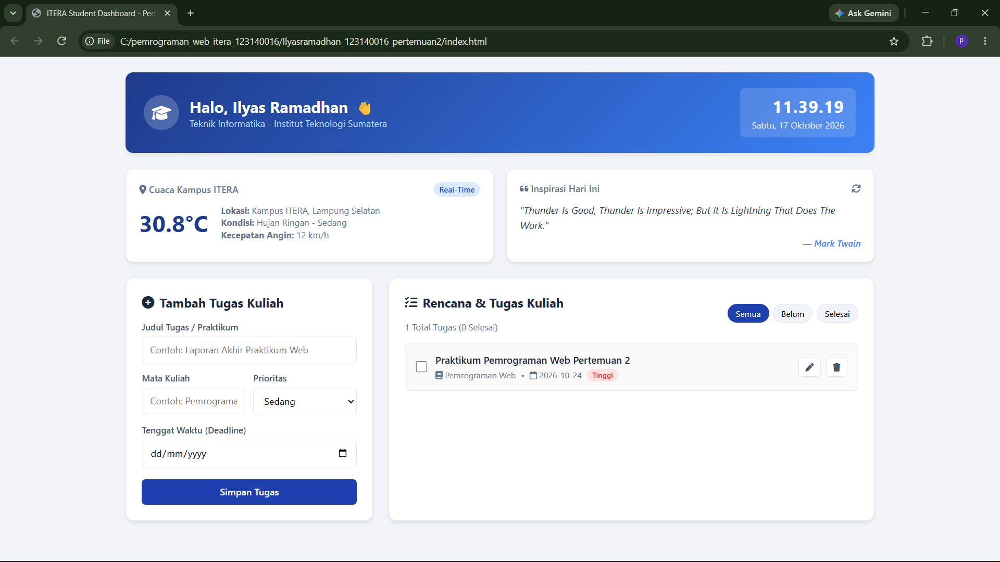
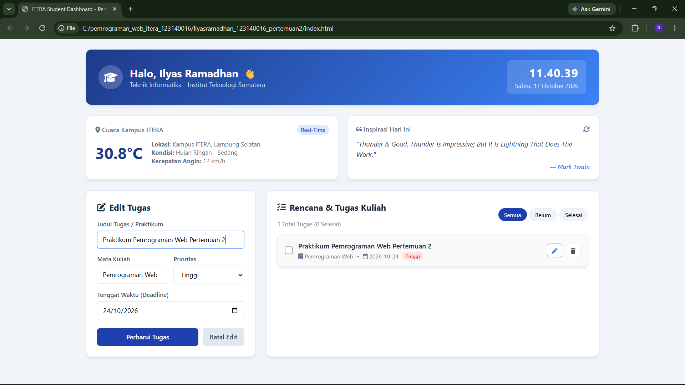

# Tugas Praktikum Pemrograman Web - Pertemuan 2
## ITERA Campus Life & Student Dashboard

---

### Identitas Mahasiswa
- **Nama Lengkap:** Ilyas Ramadhan
- **NIM:** 123140016
- **Kelas Praktikum:** [Isi RA atau RB]

---

### Deskripsi Aplikasi
**ITERA Campus Life Dashboard** adalah dashboard personal berbasis web yang dirancang khusus untuk mempermudah produktivitas mahasiswa Teknik Informatika ITERA dalam memantau perkuliahan sehari-hari. Dashboard ini menyatukan fitur pemantauan cuaca kampus ITERA secara *real-time*, kutipan motivasi harian, jam lokal otomatis, serta manajemen rencana tugas kuliah (CRUD lengkap) yang tersimpan secara lokal tanpa kehilangan data saat peramban dimuat ulang.

---

### Fitur-Fitur Aplikasi
1. **Live Weather Widget Kampus ITERA:** Menampilkan temperatur, kondisi langit, dan kecepatan angin langsung dari stasiun cuaca kampus ITERA (-5.36, 105.31) via Open-Meteo API.
2. **Kutipan Motivasi Harian:** Menampilkan kutipan inspiratif acak dari DummyJSON Quotes API dilengkapi tombol segarkan (*refresh*).
3. **Manajemen Tugas Kuliah (Interactive CRUD):**
   - **Create:** Menambah daftar tugas kuliah dengan atribut mata kuliah, prioritas (Tinggi/Sedang/Rendah), dan tenggat waktu.
   - **Read:** Menampilkan daftar tugas dengan tab filter (Semua, Belum Selesai, Selesai) serta indikator statistik.
   - **Update:** Mengedit isi tugas atau menandai status tugas selesai melalui *checkbox*.
   - **Delete:** Menghapus tugas yang sudah tidak diperlukan.
4. **Persistensi Data:** Menggunakan `localStorage` terstruktur untuk menyimpan status tugas mahasiswa.

---

### Daftar Implementasi Fitur ES6+

| Fitur ES6+ | Deskripsi Penerapan | Lokasi Berkas & Baris |
| :--- | :--- | :--- |
| **`let` dan `const`** | Deklarasi variabel tanpa kata kunci `var` untuk *scoping* yang tepat dan aman | `script.js` (Baris 8, 10, 107, 108, 137, 245) |
| **Classes** | Deklarasi OOP modern: `class TaskItem` untuk entitas data dan `class DashboardApp` untuk kontroler logika | `script.js` (Baris 9 & 20) |
| **Arrow Functions** | Implementasi fungsi ringkas untuk *methods*, *event handlers*, dan *callbacks* | `script.js` (Baris 42, 53, 54, 71, 126, 169) |
| **Template Literals** | Pembangunan markup HTML dinamis menggunakan *backticks* (`` ` ``) dan interpolasi `${...}` | `script.js` (Baris 119-126, 145-148, 222-241) |
| **Async / Await** | Pemanggilan API eksternal cuaca dan kutipan motivasi secara asinkron tanpa memblokir UI | `script.js` (Baris 105 `fetchCampusWeather` & Baris 134 `fetchDailyQuote`) |
| **Destructuring** | Ekstraksi langsung nilai properti dari objek hasil respons API dan state task | `script.js` (Baris 117, 142, 196, 224) |
| **Spread Operator** | Pembaruan array tugas secara *immutable* saat penambahan dan pembaruan item | `script.js` (Baris 186 & 190) |

---

### Panduan Menjalankan Aplikasi
1. Buka folder repositori di Visual Studio Code.
2. Masuk ke direktori: `Ilyasramadhan_123140016_pertemuan2`.
3. Klik kanan pada file `index.html` lalu pilih **Open with Live Server**.
4. Aplikasi akan otomatis terbuka di peramban web default.

---

### Tangkapan Layar (Screenshots)

1. **Tampilan Utama Dashboard & Widget Cuaca/Kutipan:**
   

2. **Tampilan Form Tambah & Edit Tugas Kuliah:**
   

3. **Tampilan Filter & Status Tugas Selesai:**
   