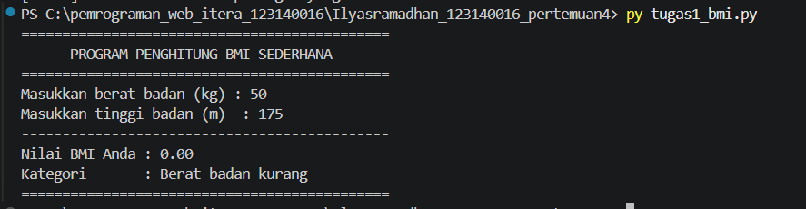
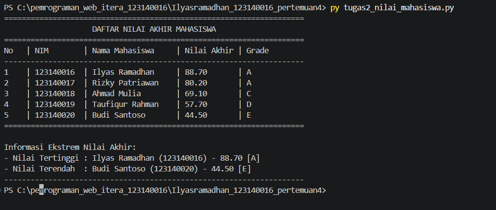
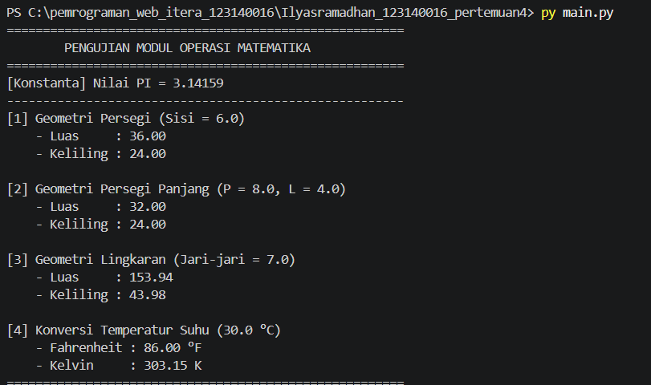

# Laporan Praktikum Pemrograman Web - Pertemuan 4
## Dasar Pemrograman Python (Variabel, Kontrol Alur, Koleksi Data, dan Modularitas)

---

### Identitas Mahasiswa
- **Nama Lengkap:** Ilyas Ramadhan
- **NIM:** 123140016
- **Kelas Praktikum:** RB
- **Program Studi:** Teknik Informatika
- **Institusi:** Institut Teknologi Sumatera (ITERA)

---

### Deskripsi Berkas & Program

1. **`tugas1_bmi.py` (Program Penghitung BMI):**
   - Menerima input berat badan (kg) dan tinggi badan (m) dari pengguna.
   - Menghitung nilai BMI menggunakan rumus: $\text{BMI} = \text{berat} / (\text{tinggi} \times \text{tinggi})$.
   - Mengelompokkan status berat badan ke dalam 4 kategori menggunakan percabangan `if-elif-else`:
     - BMI < 18.5: Berat badan kurang
     - 18.5 ≤ BMI < 25: Berat badan normal
     - 25 ≤ BMI < 30: Berat badan berlebih
     - BMI ≥ 30: Obesitas
   - Menampilkan nilai BMI yang diformat 2 angka desimal beserta kategorinya.

2. **`tugas2_nilai_mahasiswa.py` (Pengelolaan Data Nilai Mahasiswa):**
   - Menyimpan sekurang-kurangnya 5 data mahasiswa dalam list yang memuat dictionary.
   - Menghitung nilai akhir berbasis bobot: $(30\% \times \text{UTS}) + (40\% \times \text{UAS}) + (30\% \times \text{Tugas})$.
   - Menentukan predikat nilai grade A, B, C, D, atau E.
   - Menyajikan output data terstruktur dalam bentuk tabel konsol rapi menggunakan perataan format string (`f-string`).
   - Menemukan dan menampilkan mahasiswa dengan nilai akhir tertinggi dan terendah menggunakan fungsi bawaan `max()` dan `min()`.

3. **`math_operations.py` & `main.py` (Modul Matematika Kustom & Penggunaannya):**
   - `math_operations.py`: Modul yang menyediakan fungsi luas dan keliling 3 bentuk geometri (persegi, persegi panjang, lingkaran), 2 fungsi konversi suhu (Celsius ke Fahrenheit dan Celsius ke Kelvin), serta konstanta `PI`.
   - `main.py`: Skrip utama yang mengimpor modul menggunakan 2 cara berbeda (`import math_operations` dan `from math_operations import ...`) serta menampilkan seluruh kalkulasi secara terstruktur.

---

### Petunjuk Menjalankan Program di Terminal

Pastikan direktori aktif terminal berada di dalam folder `Ilyasramadhan_123140016_pertemuan4`:

1. Menjalankan Program Penghitung BMI:
   ```bash
   py tugas1_bmi.py
2. Menjalankan Program Penghitung BMI:
   ```bash
   py tugas2_nilai_mahasiswa.py
3. Menjalankan Program Penghitung BMI:
   ```bash
   py main.py

---

### Bukti Eksekusi Program (Screenshots)

#### 1. Hasil Eksekusi Soal 1 (Penghitung BMI)


#### 2. Hasil Eksekusi Soal 2 (Pengelolaan Nilai Mahasiswa)


#### 3. Hasil Eksekusi Soal 3 (Modul Matematika & Program Utama)
